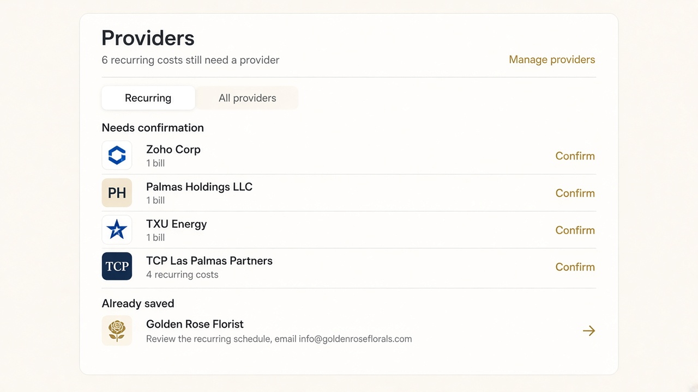
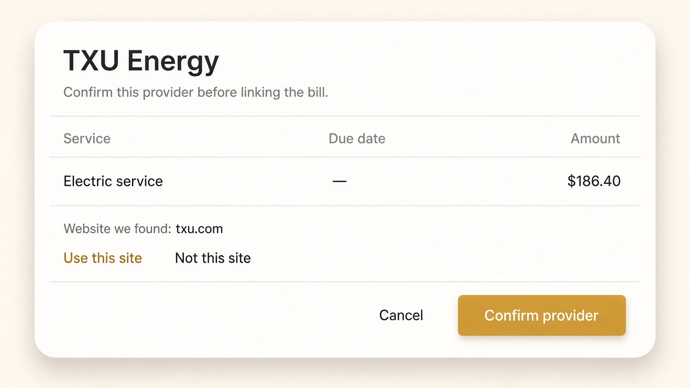

# Providers list — design notes

Read-only review of `http://localhost:3000/portal/finances?view=bill-providers` on November 9, 2026. No product code was changed.

These pictures are direction only. Names come from the live list. Amounts, due dates, and websites in the sheet are made up so the layout is readable. Do not treat them as Luxor records.

## What this screen is for

Arianna opens Providers to finish one job: attach recurring costs and bills to a saved provider, or open a provider she already has.

The current page explains the system before it shows the work.

## What is working

- Payables tabs are clear. Providers is the selected view.
- Saved providers and names that still need a provider are split into two groups.
- Each row is one tap target.
- The copy is honest: matching names are grouped, and nothing is merged until she confirms.
- “Manage providers” is available when she needs the operations list.

## What gets in the way

1. **The job is a paragraph.** The card opens with a description, then “6 active recurring schedules need a saved provider…”, then a website error, then the list. The number 6 is the useful part. The rest can wait until she opens a row.
2. **Every row is a status sentence.** Golden Rose Florist reads: “Recurring bill suggested · review schedule · Website suggested · Possible unlinked records · info@goldenroseflorals.com”. Zoho Corp reads: “1 bill · Confirm provider · Website suggested”. She cannot scan a name and a next step.
3. **“Website suggested” is on the list.** A website lookup is a detail inside the confirm step. On the list it looks like another task, and the failed lookup (“Some provider websites could not be checked”) sits above the people she actually needs to review.
4. **Confirm and open look the same.** Both groups use a gold arrow. The second group’s job is to confirm. The first group’s job is to open a record she already has.
5. **Recurring / All providers are easy to miss.** They read as two quiet labels under the warning, not as the control that changes the list.
6. **Search is early.** The list is short. A full-width search field adds a blank band before the first name.

## Direction

Keep the same information. Change what she sees first.

- One line under the title: how many recurring costs still need a provider.
- **Needs confirmation** first. Subtitle is only the count: “1 bill” or “4 recurring costs”. The row action is **Confirm**.
- **Already saved** second. Subtitle is the one thing to do next, plus the email if it helps her recognize the vendor. The row action is open.
- Recurring and All providers stay, as a real segmented control.
- Website checks move into the confirm sheet: the site we found, **Use this site**, **Not this site**, then **Confirm provider**. A failed lookup can retry inside that sheet.
- Leave the gold raised button for the confirm action. The list itself stays flat.

## Examples

List:

Confirm sheet:

The sheet example uses a placeholder amount and `txu.com`. The real sheet should show the bill Luxor already stored, and only a website the lookup actually returned.

## Leave alone until we edit

- Do not merge records from the list.
- Do not hide “Manage providers”.
- Do not add cards, badges, or a second explanation under every name.
- Do not change Receivables, Bills, or the other Payables tabs as part of this pass.
